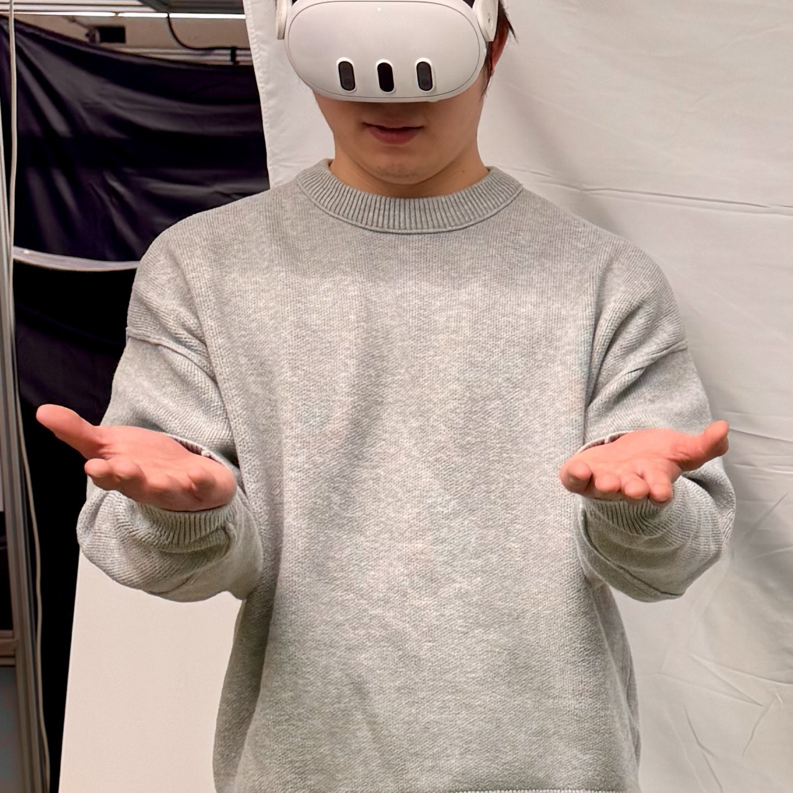
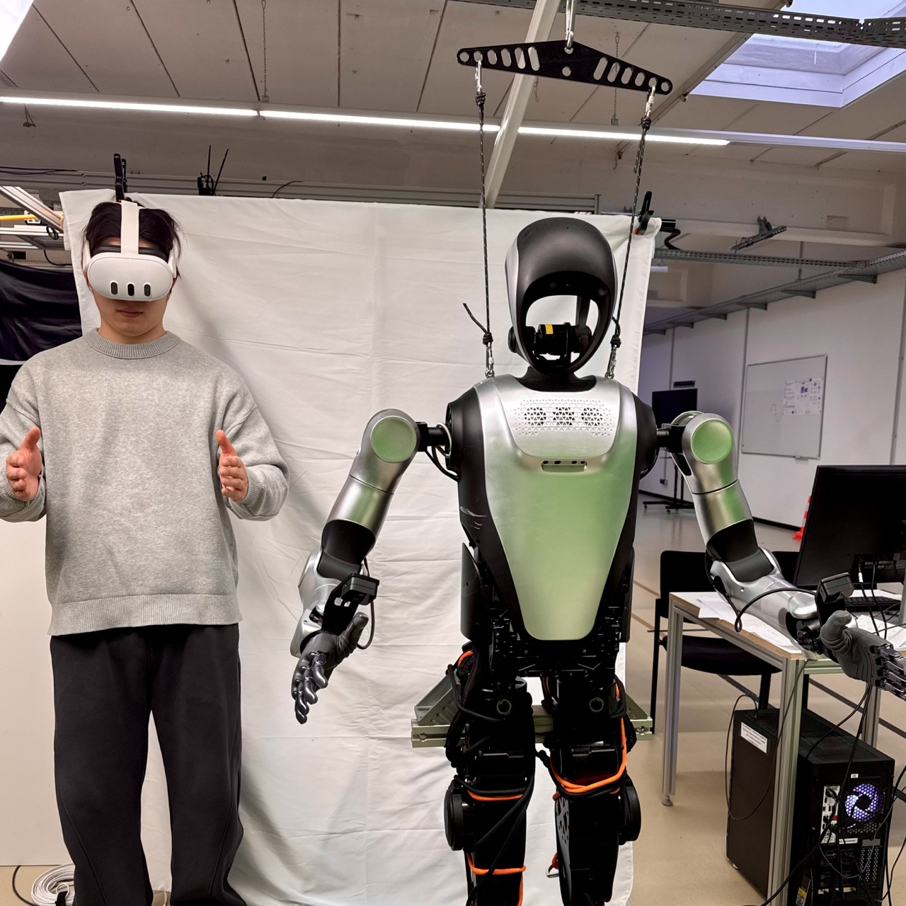
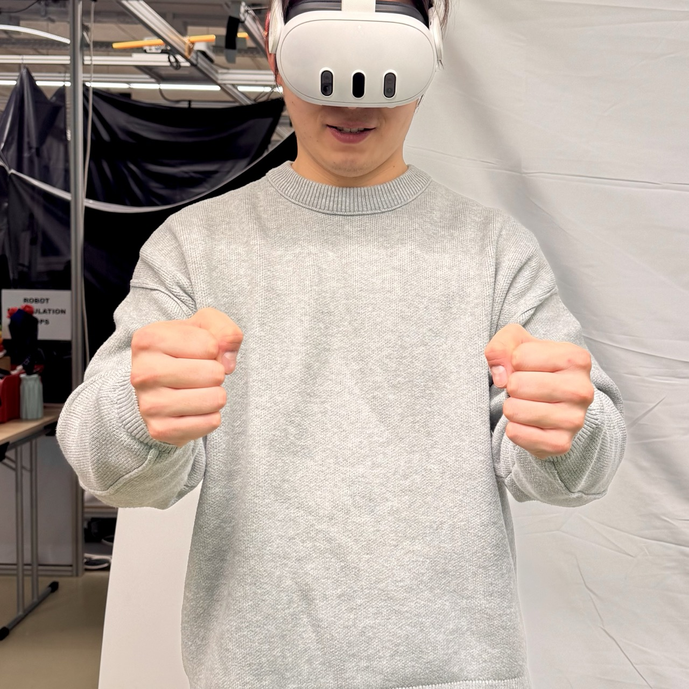
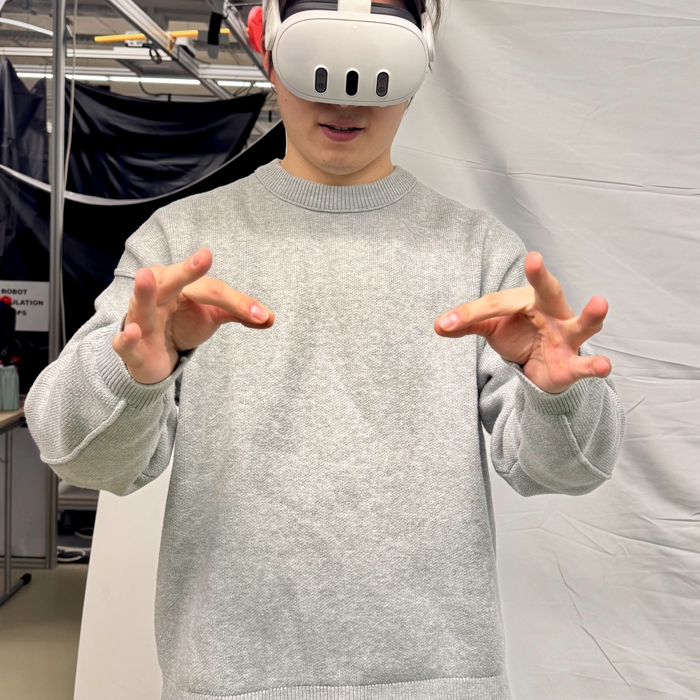

# Per-finger teleoperation & data collection of kuavo 4pro using Quest3 VR + WebXR hand tracking

This tutorial describes how to control the robot arms and individual fingers using Quest3 hand tracking via WebXR, without hand joysticks, and how to collect data using rosbag.

For joystick-based VR control, follow the [VR TELEOPERATION](teleoperation.md) tutorial.

## 1. Start the control nodes

> [!NOTE]
> The following commands are for our current robot and side machine setup. Make sure the network connection, Docker container name and certificate paths are configured according to your own setup.

### Terminal 1 (Downstream machine): Start the connection bridge and upper body control node

```bash
ssh kuavo-down
```

In downstream machine run:

```bash
sudo chmod +x setup_bridge.sh

sudo bash setup_bridge.sh

cd ~/kuavo-ros-opensource-1.3.3 # Note that we use 1.3.3 to enable control

sudo su

source devel/setup.bash

roslaunch humanoid_controllers load_kuavo_real_half_up_body.launch
# press `o` to enable control
```

### Terminal 2 (Downstream machine): Set the robot head pitch

```bash
ssh kuavo-down
```

In another terminal in downstream machine, set the robot head to look down by 25 degrees:

```bash
cd ~/kuavo-ros-opensource-1.3.3 # Note that we use 1.3.3 to enable control

sudo su

source devel/setup.bash

rostopic pub /robot_head_motion_data kuavo_msgs/robotHeadMotionData "{joint_data: [0.0, 25.0]}" -r 1
```

### Terminal 3 (Side machine): Start the WebXR teleoperation node

Enter the Docker container and source the ROS environment:

```bash
docker exec -it kuavo_container_GPU_6bdd8bcb bash

cd /root/kuavo_ws

source scripts/source_webxr_ros_env.sh \
    http://192.168.26.1:11311 192.168.26.10
```

> [!WARNING]
> Before enabling real robot motion, make sure there is sufficient space around the robot, the robot pose has been reviewed, and the emergency stop is accessible.

Start WebXR teleoperation:

```bash
roslaunch quest_webxr_bridge quest_webxr_real.launch \
    teleop_side:=both \
    cert_file:=/root/kuavo_ws/.docker-runtime/webxr-certs/pro6000-real-lan.crt \
    key_file:=/root/kuavo_ws/.docker-runtime/webxr-certs/pro6000-real-lan.key \
    start_ik:=true \
    enable_output:=false \
    enable_head:=false \
    publish_startup_head:=false \
    allow_real_motion:=true \
    real_pose_reviewed:=true
```

## 2. Enable WebXR hand tracking in Quest3

In the Quest3 browser, open the following URL:

[https://192.168.0.59:8012/?ws=wss://192.168.0.59:8012&client=201](https://192.168.0.59:8012/?ws=wss://192.168.0.59:8012&client=201)

> [!NOTE]
> The IP address in the URL is for our current side machine setup. Update both the HTTPS and WebSocket addresses if the side machine IP address changes.

## 3. Control the robot using hand gestures

> [!WARNING]
> The robot moves automatically during initial alignment, realignment and the return to home. Make sure there is sufficient space surrounding the robot, and keep your arm pose close to the robot arm pose when aligning. Keep clear of the robot's range of motion.

### 3.1 Start teleoperation

1. **Start gesture**: **open both hands with palms facing up** and hold for 5 seconds.
2. **Release the start gesture** for 1 second.
3. Wait for the robot to complete the precheck and move through the T, T_BENT and L poses.
4. **Align your arms with the robot arms** in the L pose during the 3-second preparation countdown.
5. Keep your pose stable during neutral calibration and wait for the IK handoff check to pass.
6. Once the state changes to `ACTIVE`, move your arms and individual fingers to control the robot.

<table>
  <tr>
    <td width="300" align="center"><strong>1. Start gesture</strong></td>
    <td width="300" align="center"><strong>2. L pose alignment</strong></td>
  </tr>
  <tr>
    <td align="center"></td>
    <td align="center"></td>
  </tr>
  <tr>
    <td align="center">Open both hands with palms up</td>
    <td align="center">Align your arms with the robot</td>
  </tr>
  <tr>
    <td align="center">Hold for 5 seconds,<br>then release for 1 second</td>
    <td align="center">3-second preparation countdown</td>
  </tr>
</table>


State transition:

```text
WAITING_FOR_START
  -> Open both hands with palms facing up for 5 seconds
WAITING_FOR_RELEASE
  -> Release the start gesture for 1 second
PRECHECK_AUTO_MOTION
  -> Check version, half-body mode, feedback, joint limits and control publishers
  -> Request arm control mode 2
MOVE_TO_T
  -> Reach the target pose and hold for 1 second
MOVE_TO_T_BENT
  -> Reach the target pose and hold for 1 second
MOVE_TO_L
  -> Reach the target pose and hold for 1 second
WAIT_L_REACHED
  -> Operator alignment and a 3-second preparation countdown
CALIBRATING_NEUTRAL
  -> Pass the stable calibration window
CHECK_IK_HANDOFF
  -> 10 consecutive valid IK handoff reports
ACTIVE
```

### 3.2 Pause teleoperation

**Pause gesture**: **make a fist with both hands** and hold for 3 seconds. The robot holds its current pose when the state changes to `PAUSED_HOLD`.

<table>
  <tr>
    <td width="300" align="center"><strong>Pause gesture</strong></td>
  </tr>
  <tr>
    <td align="center"></td>
  </tr>
  <tr>
    <td align="center">Make a fist with both hands</td>
  </tr>
  <tr>
    <td align="center">Hold for 3 seconds</td>
  </tr>
</table>

> [!IMPORTANT]
> The robot continues following the operator during the 3-second pause countdown.


State transition:

```text
ACTIVE
  -> Make a fist with both hands and hold for 3 seconds
PAUSED_HOLD
```

### 3.3 Resume teleoperation with realignment

1. In `PAUSED_HOLD`, **open both hands with palms facing up** and hold for 5 seconds.
2. **Release the start gesture** for 1 second.
3. Wait for the precheck and for the robot to move to the L pose.
4. **Align your arms with the robot arms** during the 3-second preparation countdown and wait for neutral calibration and the IK handoff check to pass.
5. Resume control once the state changes to `ACTIVE`.

<table>
  <tr>
    <td width="300" align="center"><strong>1. Pause teleoperation</strong></td>
    <td width="300" align="center"><strong>2. Resume gesture</strong></td>
    <td width="300" align="center"><strong>3. L pose alignment</strong></td>
  </tr>
  <tr>
    <td align="center"></td>
    <td align="center"></td>
    <td align="center"></td>
  </tr>
  <tr>
    <td align="center">Make a fist with both hands</td>
    <td align="center">Open both hands with palms up</td>
    <td align="center">Align your arms with the robot</td>
  </tr>
  <tr>
    <td align="center">Hold for 3 seconds</td>
    <td align="center">Hold for 5 seconds,<br>then release for 1 second</td>
    <td align="center">3-second preparation countdown</td>
  </tr>
</table>


State transition:

```text
PAUSED_HOLD
  -> Open both hands with palms facing up for 5 seconds
WAITING_FOR_RELEASE
  -> Release the start gesture for 1 second
PRECHECK_AUTO_MOTION
REALIGN_MOVE_TO_L
WAIT_L_REACHED
  -> 3-second preparation countdown
CALIBRATING_NEUTRAL
CHECK_IK_HANDOFF
ACTIVE
```

> [!NOTE]
> This procedure re-establishes the calibration anchors and does not move through the T and T_BENT poses again.

### 3.4 Exit teleoperation and return to the home pose

1. Pause teleoperation and wait until the state changes to `PAUSED_HOLD`.
2. **Exit gesture**: **perform the pinch gesture** and hold for 2 seconds.
3. **Release the pinch gesture** for 1 second.
4. **Confirm exit**: **make a fist with both hand** and hold for 3 seconds.
5. Wait for the robot to return to the home pose through the L, T_BENT and T poses.
6. The system requests arm control mode 1, turns off the adapter and returns to `WAITING_FOR_START`.

<table>
  <tr>
    <td width="300" align="center"><strong>1. Pause teleoperation</strong></td>
    <td width="300" align="center"><strong>2. Request exit</strong></td>
    <td width="300" align="center"><strong>3. Confirm exit</strong></td>
  </tr>
  <tr>
    <td align="center"></td>
    <td align="center"></td>
    <td align="center"></td>
  </tr>
  <tr>
    <td align="center">Make a fist with both hands</td>
    <td align="center">Perform the pinch gesture</td>
    <td align="center">Make a fist with both hands</td>
  </tr>
  <tr>
    <td align="center">Hold for 3 seconds</td>
    <td align="center">Hold for 2 seconds,<br>then release for 1 second</td>
    <td align="center">Hold for 3 seconds</td>
  </tr>
</table>


State transition:

```text
PAUSED_HOLD
  -> Hold the pinch gesture for 2 seconds
EXIT_CONFIRM_RELEASE
  -> Release the pinch gesture for 1 second
EXIT_CONFIRM_PENDING
  -> Make a fist with both hands and hold for 3 seconds
RETURN_MOVE_TO_L
RETURN_MOVE_TO_T_BENT
RETURN_MOVE_TO_T
RETURN_MOVE_TO_HOME
  -> Request arm control mode 1
  -> Turn off the adapter
WAITING_FOR_START
```

## 4. Data collection using rosbag

### Terminal 4 (Downstream machine): Start rosbag recording

```bash
ssh kuavo-down
```

Once teleoperation is ready, run the following commands in another terminal in downstream machine:

```bash
cd kuavo-ros-opensource-1.3.3

source devel/setup.bash

# before you start recording, configure the save path and rosbag name when necessary
python3 src/demo/examples_code/record_data/rosbag_tool.py

# In the terminal select: `recording the rosbag` to start the recording
# press `ctrl + c` to and save the recording
```
